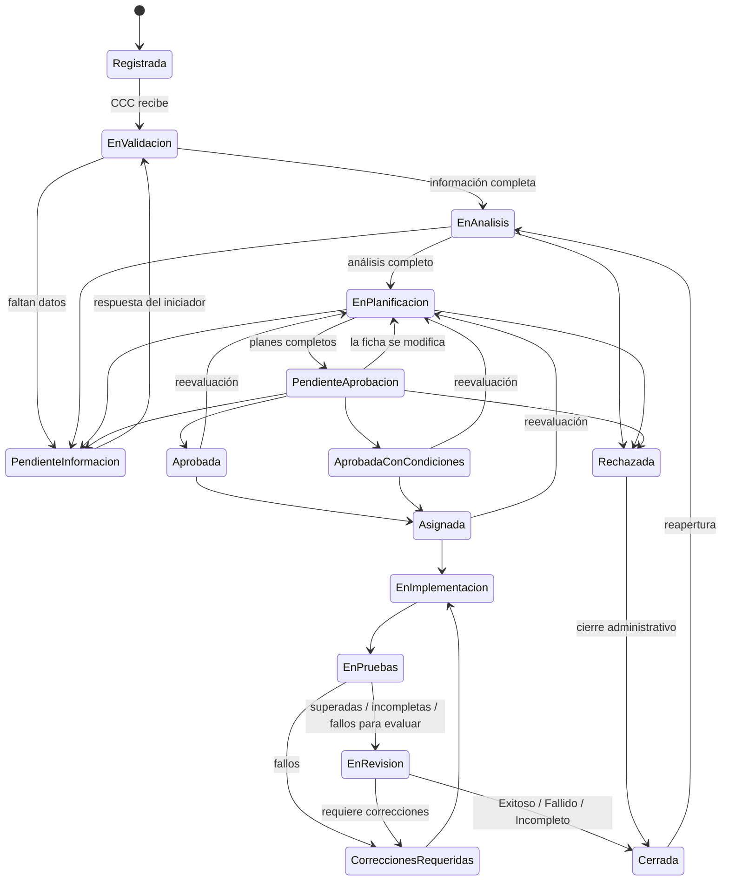

# Proceso de Administración de la Configuración del Software (ACS) en Transviajes

Sistema de control de cambios de **BusesUTA**. Es una simulación académica de la asignatura Manejo y Configuración del Software (UTA), sustentada en buenas prácticas de ACS e ITIL. **No** pretende cumplir por completo ITIL, ISO ni ningún otro estándar empresarial.

## 1. Relación teoría–funcionalidad

| Concepto de ACS / ITIL | Funcionalidad implementada |
|---|---|
| Identificación de la configuración | Catálogo de ICS (`ICS-BUS-###`), categorías configurables, objetos básicos y agregados, jerarquía sin ciclos y relaciones de dependencia |
| Control de cambios | CRF de usuario final y técnico; ficha única del CCC con clasificación, impacto, planes y decisión |
| Control de versiones | Revisiones de cada ICS (inmutables) y referencias Git registradas manualmente (rama, commit, PR, tag) |
| Línea base | Propuesta → revisión → aprobación; composición congelada mediante disparadores de SQLite; líneas base derivadas |
| Auditoría de configuración | Comparación de lo solicitado, lo autorizado, los ICS autorizados y los modificados, las evidencias y la revisión, con las desviaciones detectadas |
| Reporte de estado | Panel y reportes con indicadores, gráficos, métricas reales, filtros y exportación a CSV |
| Trazabilidad | Historial del expediente y tabla `audit_events` de solo inserción (actor, fecha, estados, campo, valor anterior y nuevo) |
| Cambio estándar / normal / emergencia | Clasificación ITIL obligatoria; las preautorizaciones estándar se validan; la emergencia admite planes resumidos y siempre exige autorización |
| Rollout / backout | Planes obligatorios antes de aprobar; el backout ejecutado se documenta por separado del planificado |
| Revisión postimplementación | Verificación de criterios, condiciones, cumplimiento del rollout, desviaciones e incidencias |
| Cierre | Resultado exitoso, fallido o incompleto, separado de la decisión de autorización y del resultado administrativo |

## 2. Recorrido del proceso

1. **Envío (CRF).** El usuario final, con o sin cuenta, o el desarrollador registra la solicitud. El servidor asigna el código `CRF-000001`, la fecha y la identidad del iniciador. El usuario sin cuenta recibe una **clave de seguimiento** aleatoria, que se guarda solo como hash; con el código y esa clave consulta el estado y responde al CCC. Los códigos secuenciales, por sí solos, no dan acceso.
2. **Recepción y validación.** El CCC recibe el CRF (`Registrada → En validación`) y verifica que esté completo. Si falta información pasa a `Pendiente de información`, lo que no equivale a un rechazo. La respuesta del iniciador lo devuelve a validación.
3. **Planificación (ficha del CCC).** Una única ficha reúne las secciones A–E:
   - **A.** Clasificación ITIL, justificación, ICS potencialmente afectados y modificaciones previstas.
   - **B.** Impacto, impacto técnico y funcional, riesgos, urgencia, prioridad, viabilidad, esfuerzo (horas-persona), duración (días), recursos.
   - **C.** Rollout ordenado, backout (o estrategia alternativa), plan de pruebas, inactividad, fecha y versión objetivo.

   La ficha admite **guardar borrador** sin marcarla como completada. «Completar análisis» exige A y B. «Completar planificación» exige C y deja la solicitud en `Pendiente de aprobación`. Si la ficha se modifica después, vuelve a planificación.
4. **Aprobación (sección D).** Aprobar, aprobar con condiciones (cada condición con su forma de verificación), rechazar o pedir más información. Aprobar requiere un análisis y una planificación completos. Un cambio **no viable** solo se aprueba con una excepción explícita y la confirmación de que se revisó el análisis. Las decisiones no se sobrescriben: una reevaluación marca la anterior como *sustituida* y registra una nueva.
5. **Asignación (sección E).** Solo con una autorización vigente. El CCC asigna a un desarrollador activo; las reasignaciones exigen motivo y conservan a los responsables anteriores.
6. **Implementación.** El desarrollador asignado consulta el plan aprobado, confirma las condiciones y registra actividades, referencias Git e **ICS realmente modificados**. Cada modificación crea una revisión nueva del ICS en estado *En cambio*, y la anterior se conserva. Modificar un ICS no autorizado genera una **desviación de alcance** que bloquea el avance hasta que el CCC la autorice o la rechace.
7. **Pruebas.** Cualquier desarrollador registra ejecuciones; se recomienda que no sea el implementador, y el sistema lo marca. Las ejecuciones no se sobrescriben: repetir una prueba crea otra ejecución. «Existen fallos» exige una incidencia y devuelve la solicitud a `Correcciones requeridas`, que abre una nueva ronda de implementación.
8. **Revisión postimplementación.** Evalúa la conformidad con lo autorizado. «Conforme» solo se acepta si las pruebas de la ronda están superadas, se cumplen todos los criterios y condiciones y no quedan desviaciones sin autorizar ni incidencias pendientes.
9. **Cierre.** Lo registra el desarrollador responsable (simplificación académica). Para un cierre «Exitoso» se requiere una revisión conforme y que no se haya ejecutado un backout en la ronda; entonces las revisiones nuevas pasan a *Vigente* y las anteriores a *Reemplazada*. Los cierres «Fallido» e «Incompleto» exigen justificación y descartan las revisiones en curso. Una solicitud rechazada se cierra administrativamente, sin resultado de implementación. El CCC puede reabrir una solicitud indicando el motivo; el cierre anterior se conserva.

## 3. Diagrama de estados implementado



`Pendiente de información` regresa a validación, como pide el flujo de referencia. La línea de progreso de la interfaz agrupa los estados en: Solicitud → Análisis → Planificación → Aprobación → Implementación → Pruebas → Revisión → Cierre.

## 4. Matriz de permisos

| Acción | Usuario final | Desarrollador | CCC |
|---|---|---|---|
| Crear CRF de usuario final (con o sin cuenta) | ✔ | — | — |
| Crear CRF técnico | — | ✔ | — (no podría evaluarse de forma independiente) |
| Editar / eliminar el propio CRF | Solo en `Registrada` | Solo en `Registrada` | — |
| Responder solicitudes de información | El propio (o con la clave de seguimiento) | El propio | — |
| Consultar solicitudes | Propias | Propias, sin cuenta, asignadas y las aprobadas alguna vez | Todas |
| Recibir, validar y completar la ficha del CCC | — | — | ✔ (salvo su propia solicitud) |
| Aprobar, rechazar, reevaluar, cerrar rechazos, reabrir | — | — | ✔ |
| Asignar / reasignar | — | — | ✔ |
| Decidir desviaciones de alcance | — | — | ✔ |
| Implementar, registrar Git, ICS modificados, backout, cierre | — | Solo el asignado | — |
| Registrar pruebas y revisión | — | ✔ (se recomienda que no sea el implementador) | — |
| Proponer ICS | — | ✔ (estado «Propuesto») | ✔ |
| Identificar ICS, editar metadatos, relaciones, revisiones manuales | — | Solo editar su propia propuesta | ✔ |
| Líneas base | — | Consulta | ✔ |
| Reportes y auditoría | — | ✔ (sobre lo que puede ver) | ✔ |

No existe un rol de administrador: la gestión de cuentas se hace con `npm run accounts:sync`. Todas las reglas se validan en `backend/service.cjs` y `backend/ics.cjs`; la interfaz solo oculta lo que el servidor rechazaría.

## 5. Diccionario de datos

**`users`**: `id`, `name`, `email` (único), `role` (`usuario` | `experto` | `ccc`), `password_hash` (scrypt con sal), `active`.

**`sessions`**: `token_hash` (SHA-256 del token de la cookie), `user_id`, `csrf`, `expires`.

**`requests`**: `id` (numérico, no reutilizable) y `owner_id` (nulo para solicitudes sin cuenta). La columna `document` es un JSON que contiene:

| Grupo | Campos principales |
|---|---|
| Identificación | `id` (`CRF-000001`), `legacyCode`, `date`, `createdAt`, `name`, `email`, `ownerId`, `submittedWithoutAccount`, `trackingHash`, `requesterType` |
| Solicitud original (inmutable tras la recepción) | `project`, `module`, `title`, `currentBehavior`, `featureMissing`, `description`, `justification`, `result`, `desiredDate`, `observations` |
| Propuesta técnica | `modificationType`, `environment`, `currentVersion`, `targetVersion`, `spec`, `specUrl`, `businessRulesAffected`, `businessRules`, `acceptanceCriteria[]`, `suggestedIcsText`, `proposedPriority` |
| Estado | `status`, `priority` (oficial, del CCC), `revision` (control optimista) |
| Validación | `validation{receivedBy, receivedAt, validatedBy, validatedAt}`, `infoRequests[]{missing, response, …}` |
| Evaluación del CCC | `evaluation{member, startedAt, analysisCompletedAt, planningCompletedAt, itilType, …, rolloutSteps[], backoutActions[], testCriteria[], downtimeValue, plannedDate, targetVersion}`, `previousEvaluations[]` |
| Decisión | `decisions[]{n, kind (Autorización / Ampliación de alcance), decision, justification, conditions[]{id, text, verification}, feasibilityException, evaluationSnapshot, superseded…}` |
| Asignación | `assignments[]{developerId, assignedBy, at, targetDate, priority, decisionN, reason, releasedAt}` |
| Implementación | `implementation.rounds[]{n, startedAt, activities[], sentToTestsAt}`, `gitRefs[]{kind, value, url, verified:false}`, `deviations[]` |
| Pruebas | `tests[]{id, round, name, expected, obtained, status, responsible, independent}`, `testRounds[]{outcome, incident}` |
| Revisión y cierre | `reviews[]`, `backouts[]`, `closure{result, administrative, …}`, `closures[]`, `reopenings[]` |
| Comunicación | `notices[]` (avisos visibles en el expediente y en el seguimiento; no se envía correo) |
| Compatibilidad | `legacy{…}` (datos del modelo anterior), `flags[]` (incoherencias marcadas para revisión) |

**`ics`**: `code` (único, `ICS-BUS-###`), `name` (único por proyecto, sin distinguir mayúsculas), `description`, `project`, `category_id`, `kind` (Básico/Agregado), `parent_id`, `owner_id`, `author_id`, `created_at`, `path`, `url`, `reference`, `status` (Propuesto / Identificado / Bajo control de configuración / Retirado), `current_revision_id`, `version`.

**`ics_categories`**: categorías configurables.

**`ics_revisions`**: `ics_id`, `revision` (única por ICS), `git_ref`, `date`, `notes`, `request_id`, `status` (Vigente / En cambio / Reemplazada / Descartada). Su contenido es inmutable y no se pueden borrar.

**`ics_relations`**: `from_id`, `to_id`, `type` (depende de / relacionado con).

**`request_ics`**: relación muchos a muchos CRF–ICS con `kind` (sugerido / potencial / autorizado / modificado), `operation`, `from_revision`, `to_revision`, `revision_id`, `in_scope`, `active`, `decision_n` y `round`.

**`baselines`**: `code` (`LB-BUS-###`), `name`, `description`, `software_version`, `status` (Borrador / En revisión / Aprobada / Rechazada), `derived_from`, creador, revisor y decisión. **`baseline_items`**: `baseline_id`, `ics_id`, `revision_id`. Los disparadores impiden cambiar la composición fuera del borrador.

**`attachments`**: `id` aleatorio, `request_id`, `context`, `filename`, `mime`, `size`, `sha256`, `stored_name`, `uploaded_by`. Los archivos se guardan en `backend/data/<base>-uploads/`, fuera de la carpeta pública, y se descargan solo con permiso sobre la solicitud.

**`audit_events`**: `at`, `entity_type`, `entity_id`, `action`, `actor_id`, `actor_name`, `from_status`, `to_status`, `field`, `old_value`, `new_value`, `justification`. Los disparadores impiden modificar o borrar eventos.

## 6. Decisiones técnicas

- **Sin dependencias externas.** Se mantienen `node:http`, `node:sqlite` y JavaScript sin framework, igual que el proyecto original.
- **Documento JSON y tablas relacionales.** El expediente sigue siendo un documento JSON, como antes, por compatibilidad. Lo que necesita consultas cruzadas o integridad referencial (ICS, revisiones, relaciones, líneas base, adjuntos y auditoría) usa tablas con claves foráneas, restricciones únicas y disparadores.
- **Migración segura (modelo 4).** Se ejecuta una sola vez dentro de una transacción. `SCR-0001` pasa a `CRF-000001`, y las rutas aceptan ambos códigos. El análisis, las resoluciones y los nombres de adjuntos anteriores se conservan en `legacy`. Las aprobaciones antiguas sin rollout ni backout quedan marcadas y exigen reevaluación antes de asignar. No se reescriben decisiones anteriores.
- **Adjuntos en base64 dentro de JSON.** Se eligió así para no añadir un analizador multipart. Límites: 5 archivos de 2 MB por envío y extensiones permitidas.
- **GitHub.** Solo se registran enlaces y referencias, marcados como «no verificado». No hay integración con la API.
- **Backout.** Se documenta; el sistema no restaura código ni datos.
- **Un único miembro del CCC.** No puede presentar solicitudes, porque nadie podría evaluarlas de forma independiente. Esto evita el bloqueo detectado en la revisión anterior.
- **Concurrencia.** Cada expediente tiene `revision`. Una escritura sobre una versión antigua recibe 409 y la interfaz recarga los datos.

## 7. Guía de demostración para la defensa

```powershell
npm run demo:reset
npm run start:demo
```

`demo:reset` crea `backend/data/demo.sqlite`, separada de la base real, con las cuentas del equipo (contraseña `SEED_PASSWORD`) y estos casos:

| Caso | Dónde verlo |
|---|---|
| **Ejemplo 1**: cancelación de boletos de principio a fin (usuario sin cuenta → aprobación condicionada → Edwin implementa → Pablo prueba y revisa → cierre exitoso) | `CRF-000001`; la auditoría de configuración señala un ICS autorizado que no se modificó |
| **Ejemplo 2**: viable pero rechazado por riesgo y esfuerzo, cerrado administrativamente | `CRF-000002` |
| **Ejemplo 3**: pruebas fallidas → correcciones → segunda ronda superada → cierre | `CRF-000003` |
| **Ejemplo 4**: `LB-BUS-001` aprobada conserva las revisiones originales (`1.2.0`, `r14`, `2.0.1`); `LB-BUS-002`, derivada, incorpora las nuevas y queda en revisión | Líneas base e `ICS-BUS-001` |
| Solicitud nueva para recorrer en vivo la recepción, la validación y la ficha | `CRF-000004` |

Recorrido sugerido:

1. Como **David** (CCC), abre `CRF-000004`: recíbelo, valídalo y completa la ficha. Prueba «Guardar borrador» y, luego, «Completar análisis» con campos vacíos para mostrar las validaciones.
2. Decide «Aprobado con condiciones» y asigna a un desarrollador.
3. Como el **desarrollador asignado**: inicia la implementación, registra una actividad, un ICS no autorizado (aparece la desviación) y una referencia de GitHub.
4. Como **David**, autoriza la desviación.
5. Como **otro desarrollador**: registra una prueba fallida, envía a correcciones, repite la prueba y realiza la revisión.
6. Cierra la solicitud como el asignado y muestra **Auditoría**, **Reportes** (exportar CSV) y la trazabilidad del ICS.
7. Para el flujo sin cuenta: cierra sesión, presenta una solicitud, guarda la clave y consulta el estado en **Seguimiento**.

Para simular varios participantes a la vez, usa perfiles de navegador distintos: las pestañas de un mismo perfil comparten la cookie de sesión.
